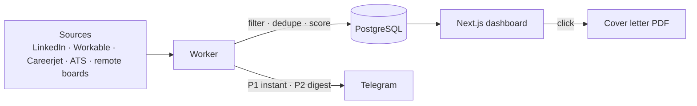

# Find Me Job — Dubai

A personal tool that watches job boards around the clock, scores each offer against a candidate profile, and sends a Telegram alert as soon as a strong match is published.

This copy is set up for a job search **in Dubai (UAE)**: customer service, reception and administration, guest relations, real estate (property consultant, leasing, sales admin) and sales coordination. The candidate is trilingual (Arabic, English, French), so French- and Arabic-speaking roles get a boost. Remote roles are accepted when they can be done from Dubai (worldwide, MENA, GCC).

## What it does

1. **Continuous collection.** Every 10 to 30 minutes, it polls several sources:
   - **LinkedIn** public job listings around Dubai (40 km radius: Sharjah and Ajman included), plus remote roles open to the UAE;
   - **Workable**: the public search across every company hiring through Workable (many Dubai agencies, hotels, clinics and SMEs);
   - **Careerjet** (UAE edition): an aggregator that picks up offers from many local sites, as a stand-in for Indeed, Bayt, GulfTalent and Naukrigulf, which block automated access;
   - the careers pages of a few companies with Dubai hubs (Greenhouse, Lever and Ashby APIs);
   - remote job boards (Remotive, Himalayas, We Work Remotely, Remote OK), filtered on worldwide / Gulf-compatible remote.
2. **Cleanup.** It filters out irrelevant titles, merges duplicates posted on several sites, and fetches the description when a source doesn't provide it.
3. **Fit score out of 100**, explained line by line in the dashboard:
   - **title (45 points)**: matches one of the targeted role categories;
   - **skills (25 points)**: languages (French, Arabic), tools and tasks from the CV found in the offer;
   - **location (20 points)**: Dubai, Sharjah/Ajman, other emirates, or remote compatible with Dubai;
   - **salary (10 points)**: amount extracted from the posting, converted to **AED per month**;
   - **penalties**: experience required in that specific role, manager titles, another language required, native English required, UAE driving licence required, Master's/MBA required…
4. **Automatic exclusions.** An offer is hidden, with the reason shown, when it is:
   - restricted to UAE nationals (Emiratisation), to one gender or to a given nationality;
   - on-site outside the UAE (including other Gulf countries);
   - remote but restricted to another country;
   - below the salary floor;
   - an internship, an operational job (F&B, housekeeping, driver…), or a senior role in a job the candidate has never held.
5. **Freshness.** The final score adds a bonus for offers less than 24 hours old and penalizes older ones. It is recomputed every 15 minutes.
6. **Prioritization and alerts.**
   - **P1**: instant Telegram alert, with *To apply / Applied / Ignore* buttons.
   - **P2**: digest at 9 am and 6 pm, Dubai time. Offers with only a short snippet (Careerjet) go here at most.
   - **P3**: dashboard only.
7. **One-click application.** For each offer, the dashboard shows which CV to send (Customer Service, Admin, Guest Relations or Real Estate variant, in English or French depending on the offer). It also generates a **cover letter tailored to the offer**, as a PDF, built only from real experience in the CV.

## Technical choices

- **A deterministic score, no LLM (for now).** Every point of the score has a readable reason: "−10: UAE driving licence required", "Other emirate: long commute"… I can fix a rule when the ranking gets something wrong, and scoring costs nothing per offer. LLM scoring is planned as a complement, not a replacement.
- **Detecting the real work mode.** LinkedIn's "remote" filter trusts what the company declares. The tool rereads the description to catch fake remote offers: "3 days in the office", "office-first", "remote-friendly"…
- **Robust salary extraction.** It handles ranges ("AED 5,000 - 6,000"), currencies (AED, USD, EUR…), pay periods (year, month, day, hour) and false positives (property prices, "AED 1.2 million").
- **Polite scraping.**
  - LinkedIn pages are read without a logged-in account, with batched queries and an automatic pause when the site answers "too many requests" (HTTP 429).
  - Indeed, Bayt and GulfTalent sit behind anti-bot protection: the tool doesn't try to get around it and relies on Careerjet's API instead.
  - Remotive's quota (4 calls per day) is respected, and every offer shows its source with a link to the original posting.
- **No alerts on the first run.** On its first collection, a source records the offers already online without notifying. Only genuinely new offers trigger an alert.
- **Cover letters without made-up claims.** Letters are assembled from real achievements in the CV, picked according to the offer's keywords. They only mention skills from a whitelist: if an offer asks for something the candidate hasn't done, the letter doesn't claim it.
- **Personal data stays out of the repository.** Contact details, salary expectations, tokens, database credentials and CVs live in `.env` and in git-ignored files.

## Stack

| | |
|---|---|
| Language | TypeScript |
| Dashboard | Next.js 16 (App Router), React 19 |
| Worker | Node.js (`tsx`): collection loops, Telegram bot (long polling), scheduled jobs |
| Database | PostgreSQL 17 |
| Parsing | cheerio (HTML), fast-xml-parser (RSS feeds) |
| PDF | Headless Chrome (cover letters and CVs rendered from HTML templates) |
| Deployment | Docker / docker-compose |



## Code layout

```
config/
  profile.ts      search profile: role categories, skills, areas, penalties, thresholds
  companies.ts    companies tracked through their ATS
  letters.ts      hooks, achievements and skills used in cover letters
src/
  sources/        one connector per source (LinkedIn, Workable, Careerjet, ATS, remote boards)
  scoring/        fit score, work mode, salary, freshness
  worker/         scheduling and ingestion pipeline
  notify/         Telegram bot (alerts, digests, /top and /stats commands)
  letters/        cover letter generation (HTML → PDF)
  app/            dashboard and API (Next.js)
  db/             SQL schema
cvs/src/          CV template and build script (CV content is not published)
```

The scoring rules, labels and comments are written in French.

## Running it

```bash
cp .env.example .env         # then fill in the Postgres password, Telegram token, contact details, salary (AED/month), Careerjet ID
npm install
docker compose up -d db      # PostgreSQL (port 5434, localhost only)
npm run worker               # collection + scoring + Telegram bot
npm run dev                  # dashboard → http://localhost:3101
```

Everything in Docker (home server):

```bash
docker compose --profile full up -d --build
```

Other commands:

```bash
npm run once                 # one pass over every source, then exit
npm run once -- linkedin     # a single source
npm run rescore              # recompute every score after editing config/profile.ts
npm run cv                   # rebuild the CV PDFs (content in cvs/src/data.mjs, not published)
```

## Next steps

- Complementary LLM scoring for borderline offers (P2/P3).
- More Dubai employers with a public careers API.
- Move hosting to a home server.
