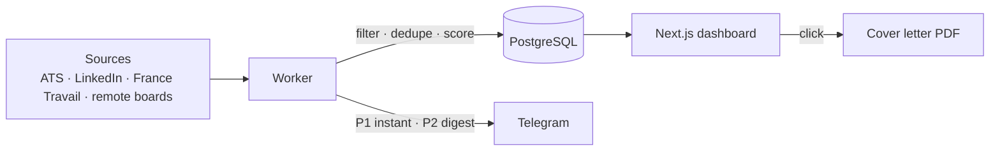

# Find Me Job

A personal tool that watches job boards around the clock, scores each offer against my profile, and pings me on Telegram as soon as a strong match is published.

I built it for my own job search (full stack development, AI integration, DevOps, project management / product ownership). It currently runs on my Mac with Docker, and will move to a home server.

## The problem

A good job offer often gets hundreds of applications within its first few hours. To get noticed, you need to apply early. You also need to apply to the right offers, not to everything.

Searching a dozen sites by hand, several times a day, takes a lot of time and still misses offers. It is also hard to tell quickly whether an offer really fits: right location, genuinely remote, high enough salary, right experience level.

## What it does

1. **Continuous collection.** Every 10 to 30 minutes, it polls several sources:
   - the careers pages of about forty companies (through the public Greenhouse, Lever and Ashby APIs);
   - LinkedIn's public job listings;
   - France Travail (the French public employment service);
   - remote job boards (Remote OK, Remotive, Himalayas, We Work Remotely).
2. **Cleanup.** It filters out irrelevant titles, merges duplicates posted on several sites, and fetches the description when a source doesn't provide it.
3. **Fit score out of 100**, computed by an algorithm and explained line by line in the dashboard:
   - **title (45 points)**: matches one of the role categories I target;
   - **skills (25 points)**: skills from my stack found in the offer;
   - **location (20 points)**: on-site, hybrid or remote, depending on the area;
   - **salary (10 points)**: amount extracted from the posting, converted to yearly euros;
   - **penalties**:
     - years of experience required, compared to my experience in that specific role;
     - required degree;
     - another language required;
     - vendor ecosystem I don't know (SAP, Dynamics…);
     - lead experience required.
4. **Automatic exclusions.** An offer is hidden, with the reason shown, when it is:
   - on-site outside my area;
   - "remote" but restricted to another country;
   - below my salary floor;
   - an internship or apprenticeship;
   - a senior role in a job I have never held.
5. **Freshness.** The final score adds a bonus for offers less than 24 hours old and penalizes older ones. It is recomputed every 15 minutes.
6. **Prioritization and alerts.**
   - **P1**: instant Telegram alert, with *To apply / Applied / Ignore* buttons.
   - **P2**: digest at 9 am and 6 pm.
   - **P3**: dashboard only.
7. **One-click application.** For each offer, the dashboard shows which CV to send, chosen from the role category and the language of the offer. It also generates a **cover letter tailored to the offer**, as a PDF, when I click.

## Technical choices

- **A deterministic score, no LLM (for now).** Every point of the score has a readable reason: "−10: 5 years of experience required", "hybrid outside my area"… I can fix a rule when the ranking gets something wrong, and scoring costs nothing per offer. LLM scoring is planned as a complement, not a replacement.
- **Detecting the real work mode.** LinkedIn's "remote" filter trusts what the company declares. The tool rereads the description to catch fake remote offers: "3 days in the office", "office-first", "remote-friendly"…
- **Robust salary extraction.** It handles ranges ("42-50k€"), currencies, pay periods (year, month, day, hour) and false positives ("$100M raised").
- **Polite scraping.**
  - LinkedIn pages are read without a logged-in account, with batched queries and an automatic pause when the site answers "too many requests" (HTTP 429).
  - Remotive's quota (4 calls per day) is respected, and every offer shows its source with a link to the original posting.
- **No alerts on the first run.** On its first collection, a source records the offers already online without notifying. Only genuinely new offers trigger an alert.
- **Cover letters without made-up claims.** Letters are assembled from real achievements, picked according to the offer's keywords. They only mention skills from my whitelist: if an offer asks for a technology I haven't used, the letter doesn't claim it.
- **Personal data stays out of the repository.** Contact details, salary expectations, tokens, database credentials and CVs live in `.env` and in git-ignored files.

## Stack

| | |
|---|---|
| Language | TypeScript |
| Dashboard | Next.js 16 (App Router), React 19 |
| Worker | Node.js (`tsx`): collection loops, Telegram bot (long polling), scheduled jobs |
| Database | PostgreSQL 17 |
| Parsing | cheerio (HTML), fast-xml-parser (RSS feeds) |
| PDF | Headless Chrome (cover letters and CVs rendered from HTML templates) |
| Deployment | Docker / docker-compose |



## Code layout

```
config/
  profile.ts      search profile: role categories, skills, areas, penalties, thresholds
  companies.ts    companies tracked through their ATS
  letters.ts      hooks, achievements and skills used in cover letters
src/
  sources/        one connector per source (ATS, LinkedIn, France Travail, remote boards)
  scoring/        fit score, work mode, salary, freshness
  worker/         scheduling and ingestion pipeline
  notify/         Telegram bot (alerts, digests, /top and /stats commands)
  letters/        cover letter generation (HTML → PDF)
  app/            dashboard and API (Next.js)
  db/             SQL schema
cvs/src/          CV template and build script (CV content is not published)
```

The scoring rules, labels and comments are written in French, since the tool is built for the French job market first.

## Running it

```bash
cp .env.example .env         # then fill in the Postgres password, Telegram token, contact details, salary
npm install
docker compose up -d db      # PostgreSQL (port 5434, localhost only)
npm run worker               # collection + scoring + Telegram bot
npm run dev                  # dashboard → http://localhost:3101
```

Everything in Docker (home server):

```bash
docker compose --profile full up -d --build
```

Other commands:

```bash
npm run once                 # one pass over every source, then exit
npm run once -- linkedin     # a single source
npm run rescore              # recompute every score after editing config/profile.ts
```

## Next steps

- Complementary LLM scoring for borderline offers (P2/P3).
- Enable the France Travail source (API credentials to create).
- Move hosting to a home server.
